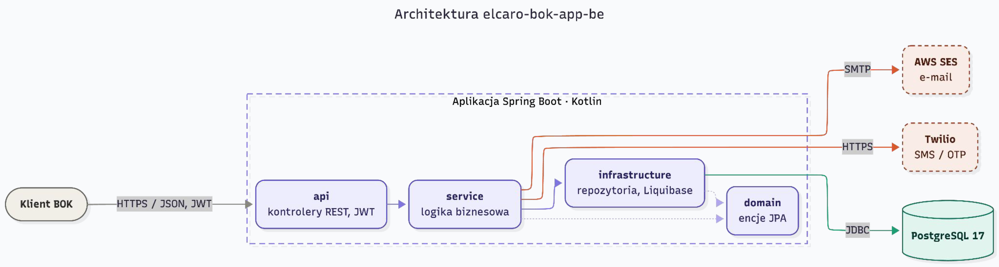
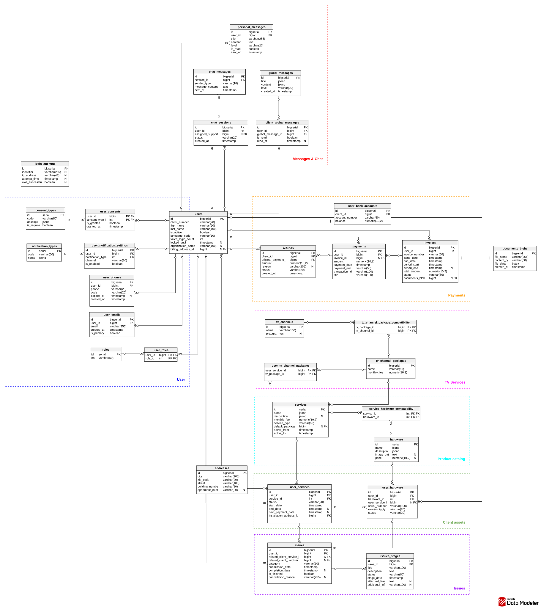

# Telecom-Portal: Customer Self-Service Application (Backend)

> **Note:** This repository contains an archived snapshot of the backend infrastructure for a commercial customer self-service web portal, developed in partnership with Elcaro. 
> 
> Full project details, architecture diagrams, and individual contributions can be verified in the official Bachelor's Thesis document located in the `docs/` folder.

📄 [**Read the full B.Sc. Thesis (PDF)**](docs/1000-LIC-INF-429682-412903-443337-450169-praca.pdf)  
📊 [**View the Project Presentation (PDF)**](docs/ZPP_36_Elcaro.pdf)

## 📌 Project Overview

A comprehensive digital self-service portal designed for a telecommunications operator. The system centralizes routine customer operations, drastically reducing the load on call centers and physical offices while improving process scalability. Customers can seamlessly manage their services, view billing history, process payments, and receive targeted notifications.

## 🏗 System Architecture

The application follows a decoupled client-server architecture. The backend serves as a stateless RESTful API, mediating all interactions between the Angular frontend and the PostgreSQL data tier.

  
*(Above: System architecture illustrating the flow between the client, Spring Boot backend, PostgreSQL, and external AWS/Twilio services.)*

## 🗄️ Database Architecture & JSONB Features

A major challenge in this project was balancing strict relational data integrity with the need for highly dynamic, schema-less content. 

* **Relational Core & Migrations:** Designed the core Entity-Relationship Diagram (ERD) and implemented versioned structural schema migrations using Liquibase to enforce strict referential integrity across the billing and service ledger.
* **Dynamic JSONB Payloads:** Utilized native PostgreSQL `JSONB` columns to store dynamic key-value pairs for localized personal messages and custom UI configuration blocks for marketing offers. This hybrid approach allowed the frontend to render complex promotional components without requiring structural migrations for every new marketing campaign.

  
*(Above: The Entity-Relationship Diagram outlining the core domains: Users, Billing, Services, and Messages.)*

## 👨‍💻 My Contributions (Pavel Charheika)

As a core Backend Engineer on this team project, I was responsible for designing the database architecture and implementing critical business modules:

* **Payments & Billing API:** Engineered the RESTful endpoints and server-side business logic for financial ledgers, invoice processing, and money-return requests.
* **Server-Side Document Generation:** Designed a PDF engine using HTML templates and the OpenPDF library to automate the creation of structured invoices and localized legal documents directly from relational records.
* **Account Settings & Security:** Built symmetric data mapping for user contact methods, notification matrices, and legal consent management. Secured the endpoints using a stateless JWT pipeline and a custom OTP verification flow.

---

## 🛠 Technology Stack

* **Language/Framework:** Kotlin (Java 25 target), Spring Boot 4.0.3 (Web, Security, Data JPA)
* **Database:** PostgreSQL 17, Hibernate ORM, Liquibase
* **Security:** Stateless JWT (JJWT), One-Time Password (OTP) verification
* **Infrastructure:** Docker, Docker Compose, AWS SES, Twilio
* **API Documentation:** springdoc-openapi (OpenAPI 3)

---

## 🚀 Quickstart & Prerequisites

* JDK 25
* Maven 3.x
* Docker and Docker Compose

**Linux:**
```bash
./start.sh
```

**Windows:**
```powershell
./start.ps1
```

This builds the JAR and starts the app + PostgreSQL via Docker Compose.

| Service    | URL                                   |
|------------|---------------------------------------|
| API        | http://localhost:8080                 |
| Swagger UI | http://localhost:8080/swagger-ui.html |

---
*This project was developed and successfully defended as a Bachelor's Thesis in Computer Science at the University of Warsaw (Faculty of Mathematics, Informatics and Mechanics) in collaboration with Elcaro.*